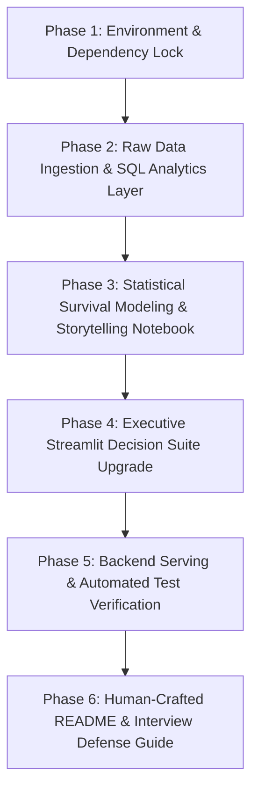

# 🚀 Project 4: SaaS Churn Survival & Cohort Intelligence Suite
## Master Hybrid Architecture, Tuning & Interview-Readiness Plan

> **Tracking Reference:** Corresponds to `data-analysis-2-advanced/` in our Master Portfolio Context (`PROJECTS_MASTER_CONTEXT.md`).  
> **Target Profile:** Hybrid **Senior Data Analyst / Decision Scientist & Analytics Engineer** (Class of 2026, CGPA 3.83/4.00, Excellent with Honors).  
> **Core Philosophy:** Combine software engineering rigor (FastAPI, modular backend, automated tests) with deep statistical modeling, biostatistical time-to-event survival analysis (`lifelines`), advanced SQL cohort window functions, and an executive-grade Streamlit decision cockpit.

---

## 1. Executive Summary & The "Hybrid Masterpiece" Vision

Most Data Analyst portfolio projects fall into one of two traps:
1. **The Pure Toy Dashboard:** A basic BI chart or static Streamlit form with no underlying data modeling, no SQL depth, and zero production engineering.
2. **The Generic Web App:** A CRUD or prediction endpoint that treats machine learning as a black box without answering core business questions: *“Where is our retention cliff? What is our monthly recurring revenue (MRR) at risk? Which contract covariates drive customer hazard rates?”*

### Our Strategic Differentiator
This project acts as an enterprise-grade **Customer Retention & Decision Science Platform**:
- **Engineering Backbone:** Maintains the clean, modular Python architecture, Pydantic validation, and FastAPI serving engine to prove CS/backend maturity.
- **SQL Analytics Core:** Introduces an explicit, rigorous SQL layer (`sql/`) solving real SaaS problems (triangular cohort retention matrices, customer lifetime activity sequencing, tenure hazard brackets).
- **Advanced Statistical Modeling:** Elevates churn from a naive binary classification problem ($0/1$) into **Biostatistical Survival Analysis** (Kaplan-Meier curves with confidence intervals, Log-Rank statistical tests, and Cox Proportional Hazards regression with Harrell’s C-index).
- **Executive Decision Cockpit (Streamlit):** Upgrades the frontend into an interactive C-level intelligence tool featuring financial impact metrics (MRR at risk, CLV forecast), cohort decay heatmaps, and prescriptive retention playbooks.

---

## 2. Target Project Architecture

```text
data-analysis-2-advanced/
├── data/
│   ├── raw/                           # Raw Telco / SaaS subscription dataset
│   └── processed/                     # Cleaned features, model artifacts, and scalers
│
├── sql/                               # ADVANCED SQL ANALYTICAL LAYER (Core DA Showcase)
│   ├── 01_schema_and_views.sql        # Relational schema & analytical views
│   ├── 02_cohort_retention_matrix.sql # CTEs + Window functions for triangular cohort decay
│   ├── 03_tenure_hazard_brackets.sql  # Tenure bracket churn velocity & ARPU analysis
│   └── 04_contract_risk_migration.sql # Window functions tracking customer contract transitions
│
├── notebooks/                         # STATISTICAL STORYTELLING & EDA
│   └── 01_saas_survival_and_cohort_analysis.ipynb
│       ├── 1. Business Context & SaaS Economics (MRR, Churn, ARPU)
│       ├── 2. Exploratory Data Analysis & Right-Censorship Mechanics
│       ├── 3. Non-Parametric Survival Analysis (Kaplan-Meier Curves)
│       ├── 4. Statistical Hypothesis Testing (Log-Rank Tests with p-values)
│       ├── 5. Semi-Parametric Modeling (Cox Proportional Hazards & Hazard Ratios)
│       └── 6. Prescriptive Business Strategy & Actionable Playbook
│
├── backend/                           # SOFTWARE & SERVING RIGOR (FastAPI)
│   ├── main.py                        # REST API endpoints for survival trajectories
│   └── src/
│       ├── data_ingestion.py          # Automated raw data ingestion & validation
│       ├── data_preprocessing.py      # Right-censorship duration/event formatting
│       ├── feature_engineering.py     # SaaS feature extraction & scaling
│       ├── model_training.py          # Lifelines CoxPH & Kaplan-Meier training pipeline
│       └── survival_predictor.py      # Production inference & hazard score engine
│
├── dashboard/ (app.py)                # EXECUTIVE STREAMLIT COCKPIT (Decision UI)
│   ├── Tab 1: Executive KPI Summary & Revenue at Risk ($MRR impact, overall retention)
│   ├── Tab 2: SaaS Cohort Retention Matrix (Interactive heatmap with cohort size)
│   ├── Tab 3: Survival Curves & Hazard Comparison (Kaplan-Meier & Log-Rank insights)
│   └── Tab 4: What-If Customer Simulator & Prescriptive Retention Playbook
│
├── tests/                             # AUTOMATED QUALITY & SENSITIVITY TESTS
│   ├── test_data_pipeline.py
│   ├── test_feature_engineering.py
│   ├── test_feature_sensitivity.py
│   ├── test_model_training.py
│   └── test_prediction_engine.py
│
├── ANALYSIS_TUNING_PLAN_2.md          # This roadmap
├── ANALYSIS_PROGRESS_2.md          # Milestone execution log
├── README.md                          # Production portfolio documentation
└── requirements.txt                   # Locked dependencies
```

---

## 3. Step-by-Step Implementation Roadmap



### Phase 1: Environment & Dependency Lock
- Verify dependencies (`fastapi`, `uvicorn`, `streamlit`, `lifelines`, `scikit-learn`, `pandas`, `numpy`, `plotly`, `seaborn`).
- Ensure the local workspace is fully configured and ready for execution.

### Phase 2: Raw Data Ingestion & Advanced SQL Analytical Layer
- Build reproducible ingestion pipeline saving the raw benchmark dataset into `data/raw/telco_churn_raw.csv`.
- Create a SQLite/DuckDB-compatible analytics layer in `sql/` to showcase complex SQL data modeling:
  1. `01_schema_and_views.sql`: Schema definitions and clean analytical views.
  2. `02_cohort_retention_matrix.sql`:
     - Calculate customer acquisition cohorts (`MIN(signup_date) OVER (PARTITION BY customer_id)`).
     - Sequence monthly activity using `DENSE_RANK()` / date difference arithmetic.
     - Compute active subscriber decay and retention percentages across periods (Month 0 to Month 24+).
  3. `03_tenure_hazard_brackets.sql`: Aggregate churn rates, monthly recurring revenue (MRR) loss, and average charges across tenure cohorts ($0-6$m, $7-12$m, $13-24$m, $25+$m).
  4. `04_contract_risk_migration.sql`: Windowed risk factor distributions (Paperless billing, Tech Support, Payment methods).

### Phase 3: Biostatistical Survival Modeling & Publication-Grade Notebook
- Construct `notebooks/01_saas_survival_and_cohort_analysis.ipynb` delivering an end-to-end data storytelling narrative:
  - **Business Problem Definition:** Contrast static churn rates with dynamic time-to-event hazard rates.
  - **Right-Censoring Deep Dive:** Demonstrate why excluding active customers causes heavy survival bias.
  - **Kaplan-Meier Curves with 95% Confidence Intervals:** Visualizing retention decay curves across Contract types, Internet Service types, and Tech Support tiers.
  - **Log-Rank Statistical Tests:** Formulate hypotheses and calculate $p$-values to prove whether contract duration significantly alters survival distributions ($p < 0.001$).
  - **Cox Proportional Hazards Regression:** Fit model with L2 regularization, interpret Hazard Ratios ($e^\beta$), and evaluate Harrell's Concordance Index (C-Index).
  - **Strategic Business Recommendations:** Prescriptive playbook for customer success teams to mitigate Day 60–90 onboarding churn cliffs.

### Phase 4: Executive Streamlit Decision Suite Upgrade
Refactor `app.py` into a modern 4-tab executive dashboard:
- **Tab 1: Executive KPI Overview & Financial Impact:**
  - High-level KPIs: Active Subscriber Base, Overall Churn Rate, Average Customer Lifetime (Months), Total MRR at Risk ($).
  - Revenue distribution charts and tenure distribution histograms.
- **Tab 2: SaaS Cohort Retention Matrix:**
  - Interactive triangular cohort heatmap showing month-over-month retention drop-offs.
  - Cohort comparison selector to spot improving/deteriorating acquisition vintage performance.
- **Tab 3: Statistical Survival & Hazard Engine:**
  - Dynamic Kaplan-Meier survival curves with interactive slice-and-dice dropdowns.
  - Visual Hazard Ratio ($e^\beta$) forest plots indicating risk accelerators vs. protective factors.
- **Tab 4: What-If Customer Simulator & Prescriptive Retention Playbook:**
  - Interactive profile sliders (Tenure, Monthly Charges, Contract, Tech Support).
  - Real-time Plotly survival trajectory curve ($S(t)$ from Month 1 to Month 72).
  - Automated prescription generator: *"Upgrading this customer from Month-to-Month to a 1-Year contract extends expected lifetime by +14 months and recovers ~$1,050 in CLV."*

### Phase 5: Backend Serving Rigor & Automated Test Verification
- Keep `backend/main.py` (FastAPI) and `backend/src/` clean, modular, and fully integrated.
- Execute the complete test suite in `tests/`:
  - Pipeline data validation
  - Feature engineering consistency
  - Feature sensitivity checks
  - Model convergence and C-index thresholds
  - Prediction engine output formats

### Phase 6: Human-Crafted Portfolio Documentation & Interview Defense Prep
- Write a senior-level, interview-bulletproof `README.md`:
  - Executive problem statement and business impact.
  - Full system architecture diagram (SQL $\rightarrow$ Lifelines Engine $\rightarrow$ FastAPI $\rightarrow$ Streamlit Dashboard).
  - Key statistical insights, SQL queries, and dashboard screenshots.
  - Step-by-step reproducibility instructions.
- Provide a dedicated **Interview Defense Cheat Sheet** covering censorship, hazard ratios, C-index, and cohort window functions.

---

## 4. Technical Interview Defense Matrix

| Question / Concept | Weak / Junior Answer | Strong "Hybrid Masterpiece" Answer |
| :--- | :--- | :--- |
| **Why not just use XGBoost / Random Forest for churn?** | *"I wanted to try survival analysis because it sounds more advanced."* | *"Binary classification predicts if someone churns in a fixed observation window, but it suffers from right-censoring: customers who are active today might churn tomorrow. Treating them as '0' introduces strong survival bias. Survival analysis models time-to-event ($T$), accounting for censored durations and predicting the exact hazard rate over time."* |
| **How did you structure the cohort analysis in SQL?** | *"I used GROUP BY and counted active customers."* | *"I used Common Table Expressions (CTEs) and Window Functions. First, `MIN(transaction_date) OVER(PARTITION BY customer_id)` identifies each user's cohort month. Then, date difference arithmetic calculates the relative cohort index ($0, 1, 2, \dots$). Finally, I join the active user count back to Month 0 cohort size to derive the retention decay percentage."* |
| **What does a Cox Hazard Ratio of 0.32 mean?** | *"It means the feature is negative for churn."* | *"In a Cox Proportional Hazards model, $HR = e^\beta$. A hazard ratio of $0.32$ (e.g., for a Two-Year Contract) means that at any given moment in tenure, a customer with a two-year contract has a $68\%$ lower instantaneous risk of churning compared to the baseline Month-to-Month cohort, holding all other covariates constant."* |
| **How did you validate model performance?** | *"I checked accuracy and confusion matrix."* | *"Accuracy is meaningless for right-censored duration data. Instead, I evaluated Harrell's Concordance Index (C-Index) on a holdout validation set. A C-index of $0.83$ indicates that when comparing pairs of customers, the model correctly predicts who churns first $83\%$ of the time."* |
